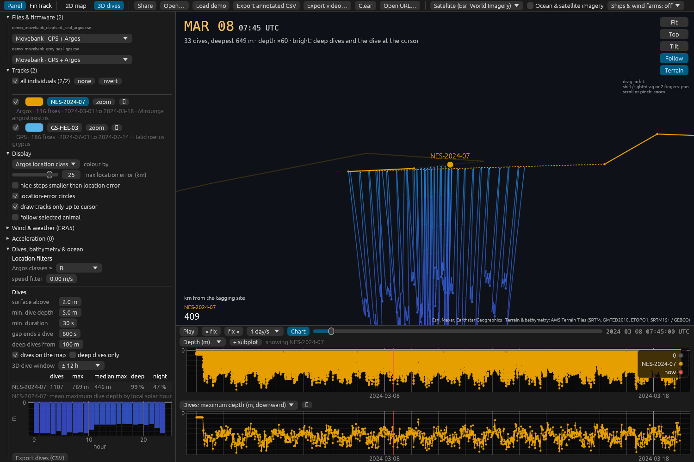
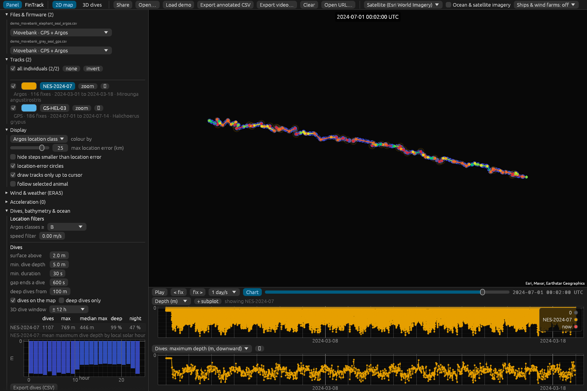

# FinTrack

An interactive tracker for **marine animals** written in Rust — the ocean twin of
[WingTrack](https://github.com/ehurme/WingTrack). Load **GPS and Argos** tracks with **depth, temperature and
acceleration** data, see **dive profiles in 3D over the seafloor**, and annotate every fix with **bathymetry,
waves, currents, sea surface temperature and wind** — next to satellite SST / chlorophyll imagery, **ship traffic**
density and **offshore wind farms**.

Runs as a native desktop app (Linux / macOS / Windows) and, from the same code, in the browser
(WebAssembly): **https://ehurme.github.io/FinTrack/**



*3D view with the simulated demo elephant seal (Argos + 1-min depth): every dive within ±12 h of the cursor is drawn
under the track at its depth, deep dives highlighted, over the seafloor relief once the bathymetry tiles load.*



*Map coloured by Argos location class, depth record (plotted downward) and maximum depth per dive, and the dive
summary with mean dive depth by local hour. Screenshots were taken offline, so no basemap tiles are shown.*

## Features

- **Import** (auto-detected, overridable per file)
  - **Movebank** exports: GPS and **Argos** locations in one file — location class (`argos:lc`), Kalman-filter
    **error ellipses** (`argos:semi-major/semi-minor/orientation`, drawn on the map), `argos:error-radius`; sensor
    rows without a position become time series: **depth** (`depth`, `tdr-depth`, `barometric-depth`; mostly
    negative columns are flipped to positive-down), **temperature** (`external-temperature`), **light level**.
  - **Any CSV** with time / lat / lon (plus optional `lc`, `depth`, `temperature` columns; ids such as `ptt`,
    `deploy_id`), e.g. tracks flattened from R (`move2`, `aniMotum`).
  - **Acceleration**: Movebank e-obs bursts, per-sample CSV (Technosmart / generic) — burst features, clustering,
    stroke frequency and per-fix summaries (see the *Acceleration* panel).
- **Argos filtering**: hide classes below a chosen one (3 … B, Z), and the **McConnell et al. (1992) speed filter**
  (RMS speed to the two previous / next fixes above a maximum swimming speed; GPS fixes are never removed).
- **Dives** (*Dives, bathymetry & ocean* panel; computed automatically from the depth record):
  - start / end at a surface threshold, maximum depth, duration, bottom time (> 80 % of the maximum), descent / ascent
    rates, post-dive surface interval, **U / V shape**; data gaps end a dive.
  - each dive is **placed on the track** (interpolated between the filtered fixes at the time of maximum depth, with the
    time to the nearest fix), with the **sun's elevation** there (day / night) and — after *Sample seafloor depth* —
    the **seafloor depth** and whether it was **benthic** (reached the seafloor).
  - **When and where animals dive deep**: dives on the map coloured by depth and sized by duration (*deep dives only*
    toggle), dive summary per track, **mean dive depth by local solar hour**, charts of the depth record and of maximum
    depth per dive (with the seafloor dashed), and a **dives CSV** export.
- **3D dives** tab: the track at the sea surface over the **seafloor relief** (bathymetry from the AWS Terrain Tiles,
  hill-shaded, basemap draped), water-column lines to the seafloor, and every dive in a window around the cursor
  (± 3 h … all) drawn **at its depth** under the track, coloured by depth; deep dives and the dive under the cursor
  are highlighted. Orbit / pan / zoom, adjustable depth exaggeration, follow the animal.
- **Ocean and weather annotation** (all free, no key):
  - **Bathymetry** under every fix and dive (AWS Terrain Tiles: ETOPO1 / SRTM15+ / GEBCO-derived in the ocean).
  - **Waves, swell, surface currents, SST and sea level incl. tides** from the
    [Open-Meteo Marine API](https://open-meteo.com/en/docs/marine-weather-api) (Météo-France SMOC currents / SST /
    sea level since 2022 at 1/12°; ERA5-Ocean waves since 1940). Current **along / across the heading** like wind support.
  - **Wind at 10 m** (and **2 m** via a logarithmic profile over the sea), temperature, pressure, precipitation and
    cloud from ERA5 via Open-Meteo — or the Copernicus CDS with your own key (*Wind & weather*).
  - **Tropical cyclones** (IBTrACS), ERA5 colour fields, isobars and storm centres.
- **Map layers** (top bar)
  - *Ocean & satellite imagery* for the day under the cursor (NASA GIBS): **sea surface temperature** and SST
    anomaly (GHRSST MUR), **chlorophyll-a** (MODIS Aqua, VIIRS), true colour, precipitation.
  - *Ships & wind farms*: **EMODnet vessel density** from AIS (all ships, fishing, cargo, tankers, passenger;
    European seas), **EMODnet offshore wind farms**, **GEBCO** bathymetry relief.
  - **Offshore wind turbines, platforms and other structures worldwide** from OpenStreetMap, with encounters along the
    tracks (*Wind turbines & offshore structures* panel).
- **Movement analysis** on demand: ctmm-style autocorrelated models (IID / OU / OUF with Argos error), home ranges
  (AKDE-like, KDE, MCP), autocorrelation-corrected speed, first-passage time, HMM and change points.
- **Charts**: depth (downward), max depth / duration per dive, seafloor, SST, waves, currents, sea level, wind at
  10 m / 2 m, temperature, acceleration and movement metrics; up to four stacked subplots on one time axis that fit
  the plotted data.
- **Exports**: annotated CSV (Movebank-like names: `argos:lc`, ellipse, `depth`, `seafloor_depth_m`,
  `wave_height_m`, `current_support_ms`, `sst_c`, `sea_level_m`, `wind_speed_2m_ms`, …), dives CSV, movement summary,
  structure encounters, video (MP4 / GIF), and **share links** that reopen the same view and data.
- **Your own API keys** stay on your device (never in share links): Open-Meteo (commercial key, higher limits) and the
  Copernicus CDS key for ERA5 (*Wind & weather → Download & annotate*).

## Installation and running

You need Rust (1.95 or newer) and Git. Everything else is downloaded automatically the first time you build.

### 1. Install Rust

**Windows**

1. Download and run `rustup-init.exe` from <https://rustup.rs>.
2. If it says the *Visual Studio C++ Build Tools* are missing, let it install them (or install
   [Build Tools for Visual Studio](https://visualstudio.microsoft.com/visual-cpp-build-tools/) with the
   *Desktop development with C++* workload), then run `rustup-init.exe` again.
3. Accept the default installation.
4. **Close and reopen** your terminal (Command Prompt, PowerShell or the VS Code terminal) so it finds `cargo`.

**macOS / Linux**

```bash
curl --proto '=https' --tlsv1.2 -sSf https://sh.rustup.rs | sh
source "$HOME/.cargo/env"        # or open a new terminal
```

On macOS, if prompted, install the Xcode command-line tools (`xcode-select --install`).
On Debian/Ubuntu, also install the libraries the window system needs:

```bash
sudo apt install build-essential pkg-config libxcb-render0-dev libxcb-shape0-dev \
  libxcb-xfixes0-dev libxkbcommon-dev libssl-dev
```

Check the install (open a new terminal first):

```bash
rustc --version      # should print 1.95 or newer; if older, run: rustup update
cargo --version
```

### 2. Get the code

```bash
git clone https://github.com/ehurme/FinTrack.git
cd FinTrack
```

(No Git? Click **Code → Download ZIP** on GitHub, unzip it, and `cd` into the unzipped folder.)
To update later, run `git pull` inside the folder.

### 3. Run the desktop app

From inside the repository folder:

```bash
cargo run --release
```

The first build downloads and compiles all dependencies and takes a few minutes. Later runs start in seconds.
The app window opens when the build finishes.

To start with the simulated demo files already loaded:

| Shell                  | Command                                              |
| ---------------------- | ---------------------------------------------------- |
| macOS / Linux / Git Bash | `FINTRACK_DEMO=1 cargo run --release`             |
| PowerShell             | `$env:FINTRACK_DEMO=1; cargo run --release`         |
| Command Prompt (cmd)   | `set FINTRACK_DEMO=1 && cargo run --release`        |

The compiled program is saved as `target/release/fintrack` (`fintrack.exe` on Windows); you can run that
file directly next time without `cargo`. Ready-made builds for Windows, macOS and Linux can also be downloaded
from the latest run on the repository's **Actions** tab (artifacts `fintrack-<os>`).

### 4. Using it

- Load data with **Open…** or by dragging CSV files onto the window. The format is detected automatically; change it
  per file under *Files & firmware* if needed.
- **Load demo** loads two simulated files (Movebank format, not real animals): an elephant seal with Argos locations
  and 1-min depth (deep foraging dives off California) and a grey seal with GPS and benthic dives around Helgoland
  between offshore wind farms.
- *Dives, bathymetry & ocean*: set the dive thresholds, **Sample seafloor depth**, **Annotate with ocean data**.
- **3D dives** tab: the dives around the cursor in 3D. Space plays / pauses, ← / → step between fixes.

### Optional: video export as MP4

GIF export works out of the box. For MP4, install [ffmpeg](https://ffmpeg.org/download.html) and make sure
`ffmpeg -version` works in a new terminal (Windows: `winget install ffmpeg`; macOS: `brew install ffmpeg`;
Ubuntu: `sudo apt install ffmpeg`). Restart FinTrack afterwards.

### Optional: run in the browser

```bash
rustup target add wasm32-unknown-unknown
cargo install --locked trunk          # one-time, takes a few minutes
trunk serve --release                 # then open http://127.0.0.1:8080
```

### Tests

```bash
cargo test --lib      # parsers, dives, ocean / weather annotation, geodesy, export round-trip, video encoding
```

### Troubleshooting

| Problem | Fix |
| ------- | --- |
| `'cargo' is not recognized` / `cargo: command not found` | Rust is not on your PATH yet — open a new terminal. On Windows, re-run `rustup-init.exe` if it still fails. |
| `'trunk' is not recognized` | Install it: `cargo install --locked trunk` (only needed for the browser version). |
| `linker 'link.exe' not found` (Windows) | Install the Visual Studio C++ Build Tools (step 1). |
| `package requires rustc 1.95` | `rustup update` |
| `could not find Cargo.toml` | You are not in the repository folder — `cd` into `FinTrack` first. |
| MP4 greyed out in *Export video* | ffmpeg was not found on PATH; install it and restart the app, or use GIF. |

### Continuous integration

Pushing to `main` on GitHub runs `.github/workflows/ci.yml`: tests + clippy, desktop builds for
Linux/macOS/Windows (downloadable artifacts), and a web build deployed to GitHub Pages
(enable *Settings → Pages → Source: GitHub Actions*).

## Adding a tag type / firmware

Implement the `Firmware` trait in `src/firmware/` and add it to `registry()`:

```rust
pub trait Firmware: Send + Sync {
    fn id(&self) -> &'static str;          // stable id, written to exports
    fn label(&self) -> &'static str;       // shown in the per-file dropdown
    fn description(&self) -> &'static str;
    fn detect(&self, t: &Table) -> f32;    // 0..1 confidence from the header (and rows)
    fn parse(&self, t: &Table) -> Result<ParseOutput, String>;
}
```

`Table` gives tolerant column lookup on normalised headers (`"argos:semi-major"` → `argos_semi_major`).
Fixes carry location source (GPS / Argos), error radius, Argos class and ellipse; depth, temperature and other
sensor samples go into `Track::sensors` so they appear in the charts (and depth in the dive analysis) automatically.

## Notes and limits

- **Dive positions** are interpolated between location fixes — with Argos fixes hours apart and km-scale errors, the
  position of a single dive is uncertain (the dives CSV gives the time to the nearest fix). Use the class and speed
  filters, or a state-space model in R (e.g. `aniMotum`) and import its output, for the best track.
- **Bathymetry** comes from the AWS Terrain Tiles at ~150 m (zoom 10); in the open ocean the underlying grids are
  coarser (ETOPO1 / SRTM15+). "Benthic" means within 15 m or 10 % of that depth.
- **Open-Meteo Marine**: currents, SST and sea level start in 2022; earlier tracks get waves only (ERA5-Ocean, 0.5°).
  Values come from the nearest 0.1° sea cell; free use ≈ 10 000 calls / day.
- **EMODnet** layers (vessel density, wind farms) cover European seas; elsewhere use the OpenStreetMap structures.
  Individual ship tracks (AIS) need commercial providers and are not included.
- Some services may not allow browser (CORS) requests; the desktop app always works.
- Coordinates and times are treated as WGS84 and UTC.

## Code layout

| File | Role |
| ---- | ---- |
| `src/model.rs` | `Track`, `Fix` (Argos class / ellipse, depth), `SensorSample`, ocean & weather annotation structs |
| `src/table.rs` | CSV reader (delimiter sniffing, header normalisation, timestamp formats) |
| `src/firmware/` | `movebank.rs` (GPS + Argos + sensor rows), `generic.rs`; trait, registry and helpers in `mod.rs` |
| `src/dives.rs` | dive detection and statistics, positions, by-hour summary, dives CSV, Argos speed filter |
| `src/marine.rs` | Open-Meteo Marine planning, cache and annotation; 2 m wind |
| `src/terrain.rs` | Terrarium tiles: terrain and bathymetry for the 3D view and the seafloor under fixes |
| `src/weather.rs`, `src/cds.rs` | ERA5 via Open-Meteo or the Copernicus CDS (user key) |
| `src/tiles.rs` | basemaps, NASA GIBS (SST, chlorophyll, true colour), EMODnet / GEBCO overlays |
| `src/view3d.rs` | CPU-projected 3D view: seafloor, dives under the track, structures |
| `src/structures.rs` | OpenStreetMap wind turbines / offshore structures and encounters |
| `src/movement.rs` | home range, autocorrelated models, speed, FPT, HMM, change points |
| `src/acc.rs` | acceleration bursts, features, clustering |
| `src/app.rs`, `src/app/` | egui UI (`ocean_ui.rs`: dives / bathymetry / ocean panel; `movement_ui.rs`) |
| `src/demo.rs` | simulated demo files (Movebank format) |

MIT licence. Map data © OpenStreetMap contributors, Esri, CARTO; imagery NASA EOSDIS GIBS; bathymetry AWS Terrain
Tiles / GEBCO; ocean data Open-Meteo (Météo-France SMOC, ECMWF ERA5-Ocean); weather ERA5 (Copernicus); ship
density and wind farms EMODnet Human Activities.
